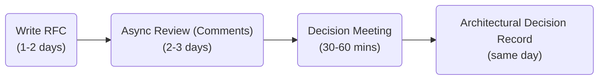

# Ways of Working

How we document, decide, set up, test and secure our work. These pages cover the habits that apply across projects: structured documentation, a lightweight decision process, a common project baseline, a layered testing approach, realistic test data, security from the start of design, and accessibility.

## Documentation (Diátaxis)

Structure documentation using the [Diátaxis](https://diataxis.fr/) framework: identify whether you are writing a tutorial, a how-to guide, reference, or explanation, and do not mix them in one document.

The four types:

- **Tutorial**: a lesson that takes a beginner through a complete, safe exercise ("build your first service with our template").
- **How-to guide**: steps to accomplish a specific task for someone who knows the basics ("add a new environment to Terraform").
- **Reference**: dry, accurate description for looking things up ("configuration options for the OIDC handler").
- **Explanation**: background and reasoning for understanding ("why we use a BFF").

Guidance:

- Before writing, decide which of the four types the document is. Most bad documentation mixes types; a how-to that drifts into explanation loses the person who just wants the steps.
- Match the type to the reader's situation: learning (tutorial), working (how-to), looking something up (reference), understanding (explanation).
- Our own documentation follows this split: an ADR is reference, the standards overview is reference with light explanation, and the principles pages are explanation.
- Keep reference material dry and complete; keep explanation out of it and link to it instead.

Why it matters: documentation fails when it answers a different question than the reader has. Someone debugging at 22:00 needs a reference, not a tutorial; a new team member needs a tutorial, not reference. Naming the four types makes the mismatch visible and fixable, and gives writers a clear answer to "where does this content go?"

Related: [23 Documentation and Decisions](../standards/23-documentation-and-decisions.md), [Making Decisions: RFC and ADR](#making-decisions-rfc-and-adr), [20 Screenshots and Visual Documentation](../standards/20-screenshots-and-visual-documentation.md).

## Making Decisions: RFC and ADR

Make significant decisions in four steps: a written RFC, an async review period, a focused decision meeting, and an ADR recording the outcome.



- **RFC (Request for Comments):** a document that explains the problem, proposes solutions, and invites feedback. This is the async preparation phase.
- **Decision meeting:** a focused synchronous discussion where the decision is actually made. Everyone has already read the RFC and comments.
- **ADR (Architecture Decision Record):** the final record of what was decided and why. This becomes part of the permanent record.

### Step 1: Write the RFC

The RFC is where the heavy lifting happens. It forces the problem to be thought through properly before others are brought in. Do not skip it: jumping straight to a meeting is how you get two-hour discussions that go in circles.

RFC template:

```markdown
**Author:** [Your name]
**Date:** [Date]
**Status:** Draft | Under Review | Decided | Superseded
**Decision Deadline:** [Date - usually 3-5 days from creation]

## Summary

One paragraph. What is this about and why are we discussing it?

## Context

What's the current situation? What problem are we solving? Why now?
Include relevant constraints, requirements, and background.

## Priorities and Requirements (Ranked)

The most important part. List what actually matters for this decision, in order
of importance. Be specific and quantifiable where possible. For example:

1. **Cost** - We operate at thin margins; any infrastructure cost increase directly impacts profitability.
2. **Development velocity** - The roadmap depends on shipping three features this quarter.
3. **Operational complexity** - We have a small ops team; anything complex creates bottlenecks.

## Proposed Solutions

### Option A: [Name]

Description of the approach.

**How this performs against priorities:**

- **Cost:** [Impact and direction — High/Medium/Low]
- **Development velocity:** [Impact]
- **Operational complexity:** [Impact]

**Estimated effort:** X weeks/months
**Risk level:** Low | Medium | High
**Other trade-offs:** [Anything else worth noting]

### Option B: [Name]

...

### Option C: Do Nothing

Often worth including. Sometimes the answer is "not now".

## Recommendation (Optional)

Which option is recommended and why? Focus on how it aligns with the ranked priorities.

## Stakeholders

Who needs to be involved? Tag them and say what you need from each:

- @backend-team (affected by implementation)
- @security-team (compliance implications)
- @product-owner (timeline impact)

## Open Questions

What still needs input?

## Timeline

When does this decision need to be made, and what's driving that deadline?
```

**Why priorities beat pros/cons lists.** The template ranks priorities instead of listing pros and cons. A pros/cons list tells you what varies between options, but not whether it matters:

```text
Option A
Pros: Fast, Scalable
Cons: No access management
```

This is almost useless unless everyone already agrees on what is important. Does speed matter more than access management? Different readers reach different conclusions, and the loudest voice in the meeting wins, not the best decision.

Ranking priorities first, then evaluating options against them, tells a clear story:

```text
Priorities:
1. Must support access management (business requirement)
2. Performance under 500ms (SLA requirement)

Option A: Fast, scalable, but no access management → fails priority #1, ruled out.
Option B: Slower but supports access management → meets #1, still hits 500ms → recommended.
```

When priorities are ranked and clear, the decision often becomes obvious. When people disagree, the debate is about what actually matters, which is where real consensus-building happens.

**Tagging the right people.** Tag everyone who:

- will be affected by the decision (they need to know)
- has relevant expertise (they can improve the decision)
- has authority over the affected area (they need to approve)
- will implement it (they will spot practical issues)

Do not tag the entire company. Tell people explicitly what is needed: "Please read this RFC and comment by [date]. The decision meeting is [date]." Not everyone needs to analyze every option; some just need to flag a blocker from their perspective.

### Step 2: Async review period

Give people 2-3 days to read and comment. Async comments let people think before responding, do research, and sleep on it, which gives better feedback than putting people on the spot in a meeting.

Good comments are:

- clarifying questions ("How would this handle X scenario?")
- concerns ("This might conflict with Y initiative.")
- additional context ("We tried something similar before and hit Z issue.")
- preferences ("I lean toward Option B because...")
- alternatives ("Have we considered W approach?")

As the RFC author, engage actively: answer questions, acknowledge concerns, and update the RFC when someone raises a valid point. This builds consensus before the meeting.

If nobody comments:

- **The decision is not important enough.** Maybe it does not need a formal process. Just decide.
- **People are too busy.** Ping individuals directly about the specific section you need input on.
- **It is too long or complex.** Simplify, and add a TL;DR at the top.
- **People agree but are silent.** Explicitly ask for a "+1 if you're okay with the recommendation".

### Step 3: The decision meeting

This is the synchronous part, but it is not a presentation meeting. Everyone should already have read the RFC and the comments.

Run a working session. Suggested agenda:

1. **Quick context (2 min):** "We're here to decide X. Everyone's read the RFC."
2. **Open questions (10-15 min):** work through unresolved comments and open questions.
3. **Discussion (15-30 min):** debate the options, raise new concerns.
4. **Decision (5-10 min):** make the call.

Who should be there: the RFC author (runs the meeting), key stakeholders who commented, and the decision maker. Keep it small, 5-8 people at most. Large meetings turn into status updates, not decision forums.

Decision-making methods:

- **Consensus:** everyone agrees. Ideal but not always realistic.
- **Consent:** nobody has strong objections. Ask "can you live with this?" rather than "is this your favorite?"
- **RAPID / DRI:** one Directly Responsible Individual makes the final call after hearing input. Often best for architecture decisions, where someone needs to own the outcome.
- **Majority decision:** works for minor decisions but tends to create winners and losers. Use sparingly.

If the group cannot agree:

- **Escalate.** A clear owner or manager above the group can break the tie.
- **Time-box.** "Let's try Option A for 3 months and revisit." Not everything needs to be decided forever.
- **Do more research.** If the disagreement is factual ("will this scale?"), run a spike or proof of concept first.
- **Reduce scope.** Agree on a subset: "we disagree on the long-term approach, but agree on the first step."
- **Acknowledge trade-offs.** Make the differing priorities explicit: "you're prioritizing speed, I'm prioritizing maintainability; which matters more here?"

Do not let disagreement fester. Unresolved architecture decisions turn into technical debt as people implement different approaches in parallel.

### Step 4: Write the ADR

Once decided, document it. The ADR is the permanent record. It differs from the RFC: the RFC explored options, the ADR records what was chosen.

```markdown
# ADR-[number]: [Title]

**Date:** [Date]
**Status:** Proposed | Accepted | Rejected | Superseded by ADR-XXX

## Context

What issue is motivating this decision?

## Decision

What is the change being made?

## Consequences

What becomes easier or harder because of this change?

## Alternatives Considered

Brief summary of the options that were rejected and why.
```

Keep ADRs short; they are reference documents, not essays. Link back to the RFC for full context. How much detail and formality to use is up to each team.

### Rollout and checkpoints

Making the decision is only half the work. An RFC should include a concrete rollout plan: not just "we'll implement this" but a clear path from the current state to the desired outcome.

Many architecture decisions fail not because the decision was wrong, but because the implementation path was unclear or too ambitious. People push back on "massive paradigm shifts" not because they disagree with the direction, but because they cannot see how to get there incrementally.

The RFC author drafts the rollout plan; the people who will implement it (team leads, architects, tech leads) refine it, since they will spot what is realistic. Include it in the RFC; it is part of the decision, and often where the most important feedback comes from.

### When stakeholders need to be involved

Not every decision needs the full process:

- **Just decide (no RFC):** affects only your team, easily reversible, low cost to change later.
- **Lightweight RFC (async only, maybe no meeting):** affects 2-3 teams, medium impact, someone might have concerns.
- **Full process (RFC, meeting, stakeholders):** cross-cutting concerns (security, performance, cost), hard to reverse (database choices, API contracts), significant investment, or needs budget or headcount.
- **Executive involvement:** affects company strategy, large budget, external vendor commitments, or compliance and legal implications.

For the biggest decisions, present a summary to leadership. That is separate from the technical decision meeting: it is about approval and resources, not debating trade-offs.

### Using AI assistance

LLMs are useful for RFC preparation: researching trade-offs between technologies, drafting initial option write-ups, summarizing documentation, and surfacing edge cases you might have missed. Use the LLM as a thought partner, and do not let it write the whole RFC unreviewed. Verify facts it provides against authoritative sources.

### Common pitfalls

- **Analysis paralysis:** the process becomes an excuse never to decide. Set deadlines and stick to them.
- **Too many stakeholders:** everyone has an opinion, nothing gets decided. Be explicit about who has input versus decision authority.
- **No follow-through:** the decision is made but no ADR is written, and six months later nobody remembers why. Write the ADR the same day.
- **Ignoring the quiet people:** loud voices dominate meetings. The async comment period is where quieter members contribute, so value those comments.

### Summary

1. Write an RFC with clear options and ranked priorities.
2. Give people time to read and comment async.
3. Hold a focused meeting to make the decision.
4. Record it in an ADR.

The amount of detail and the length of deadlines depend on the team. The process works both with heavy formality and in a quick, low-bureaucracy style.

Related: [23 Documentation and Decisions](../standards/23-documentation-and-decisions.md), [Code design principles](code-design.md), [Architecture and domain principles](architecture-and-domain.md).

## Project Setup Checklist

Every new service or app starts from the same baseline. Get these in place before writing feature code; retrofitting them later is far more expensive.

- [ ] **GitHub repository** created, with branch protection on the default branch.
- [ ] **Minimal running setup** for both API and frontend (a hello-world that builds and runs end to end).
- [ ] **CI/CD pipeline** that builds, tests, and deploys through the environment chain.
- [ ] **Warnings as errors** turned on for every project.
- [ ] **Nullable reference types** enabled (.NET) / **strict** mode enabled (TypeScript).
- [ ] **Code formatter** configured and enforced in CI.
- [ ] **Linter** configured and enforced in CI.
- [ ] **Dependency scanning** enabled.
- [ ] **HTTPS** working in local development.

The full adoption checklist, with the standard each item comes from, is the baseline checklist in the docs README (and in the agent skill).

Why it matters: the baseline is cheapest to establish when the repo is empty. A codebase that started with warnings-as-errors and strict nullability stays clean; one that turns them on after 50k lines faces an unpayable backlog and turns them off again.

Related: [01 Repository Layout and Build](../standards/01-repository-layout-and-build.md), [02 Local Development](../standards/02-local-development.md), [05 CI Pipeline](../standards/05-ci-pipeline.md), [06 Deployment and Release](../standards/06-deployment-and-release.md), [17 Supply Chain and Security Scanning](../standards/17-supply-chain-and-security-scanning.md), [25 Code Quality Guards](../standards/25-code-quality-guards.md).

## Testing Strategy

We use a layered test approach: fast unit tests for business logic, integration tests for the imperative shell, and end-to-end tests for the full user journey.

The layers:

- **Unit tests**: pure business logic only, no dependencies, no mocks. These test the functional core and should be fast and deterministic.
- **Integration tests**: test the imperative shell. Database, message bus, external calls. This is where you verify that your components wire together correctly.
- **End-to-end tests**: test the full system from the frontend, including authentication. These are slower and more brittle, so keep them focused on critical user flows.

Write tests in BDD style (Given/When/Then) to keep them readable and aligned with business intent.

Guidance:

- Do not write mocks or substitutions in unit tests. If you need to mock something, the logic is probably in the wrong layer.
- Contract tests are a good option for shared APIs that multiple teams consume.
- Avoid having only E2E tests; they are slow to run and hard to debug.

Example: a pricing rule is unit-tested, the API handler is integration-tested with a real database, and a full checkout flow is validated in E2E with authentication.

Related: [19 Testing Strategy](../standards/19-testing-strategy.md), [Realistic Test Data](#realistic-test-data), [Code design principles](code-design.md).

## Realistic Test Data

Test data should look like production data. If your tests only run on simple, happy-path examples, they will not catch the edge cases that always exist in real usage.

Guidance:

- When you discover an edge case in production, add it to the test dataset. Make it a habit.
- Keep datasets representative of production behavior: varied, somewhat messy, realistic.
- Avoid synthetic data that hides real constraints (for example all IDs being `1`, all names being "Test User").
- Generate seed data from production-like schemas and distributions. Never copy production data and scrub it afterwards; see [18 Personal Data and GDPR](../standards/18-personal-data-and-gdpr.md).

Why it matters: bugs that only appear with real data are the worst kind, because they are invisible until they hit production. Realistic test data is one of the cheapest ways to find them early.

Example: when a rare billing edge case is discovered in production, it is added to the shared test dataset and covered by a regression test.

Related: [Testing Strategy](#testing-strategy), [19 Testing Strategy](../standards/19-testing-strategy.md), [18 Personal Data and GDPR](../standards/18-personal-data-and-gdpr.md), [07 Preview Environments](../standards/07-preview-environments.md).

## SecOps (Shift Left)

Security is not a final check before release. It starts during design and is wired into the CI/CD pipeline. The earlier you catch a security issue, the cheaper it is to fix.

Guidance:

- Treat security as a shared responsibility across the team, not something a security review handles at the end.
- Run SAST and dependency scanning on every pull request.
- Include security considerations in design discussions for any significant feature.
- Set clear pass/fail thresholds for automated checks, and do not let high-severity findings sit unaddressed.

Example: SAST and dependency scanning run on every PR. High-severity findings block merging. A design doc for a new payment flow includes a section on authentication and data handling.

Related: [17 Supply Chain and Security Scanning](../standards/17-supply-chain-and-security-scanning.md), [16 HTTP Security Hardening](../standards/16-http-security-hardening.md), [Security principles](security.md), [06 Deployment and Release](../standards/06-deployment-and-release.md).

## WCAG

Accessibility is a core requirement. We follow the Web Content Accessibility Guidelines so our products work for everyone.

Guidance:

- Use semantic HTML: the right elements for the right purpose (`<button>` for buttons, `<nav>` for navigation, and so on).
- Ensure keyboard navigation works throughout the application.
- Provide visible focus states, so users who navigate with a keyboard can see where they are.
- Test with actual assistive technology (screen readers) where possible. Automated tools catch only a part of the issues, roughly 30% by common estimates.
- Do not rely solely on color to convey information.

Why it matters: accessibility improves usability for everyone, not just users with disabilities. Good semantic HTML also tends to produce better SEO and more robust tests. Ignoring accessibility is also a legal risk.

PrimeVue's built-in components are accessible by default; prefer them over custom implementations.

Example: form inputs have visible labels, proper `aria-*` attributes, and work with keyboard navigation.

Related: [21 Frontend](../standards/21-frontend.md), [Vue frontend technology](../technology/frontend-vue.md).
