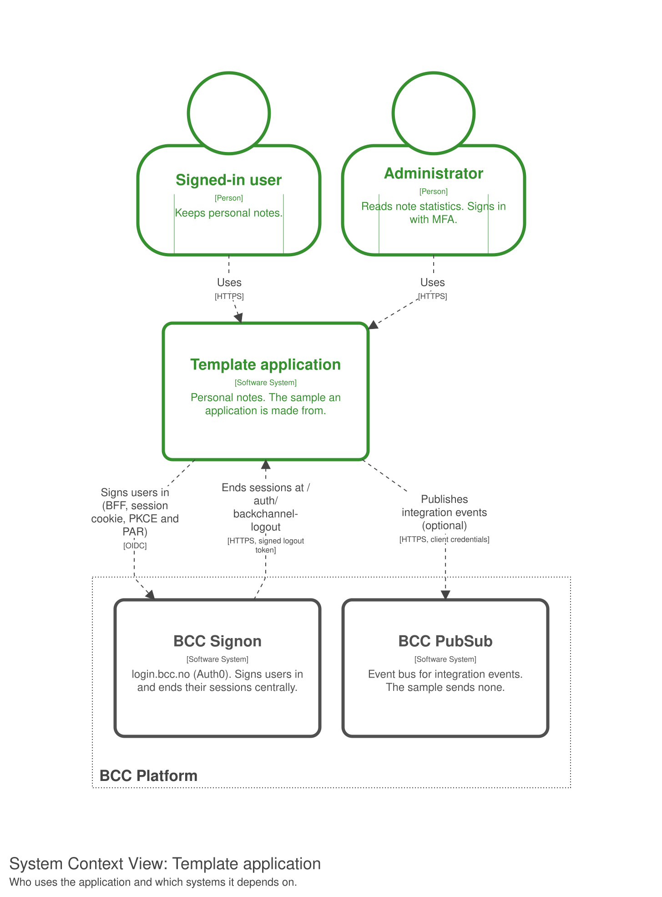
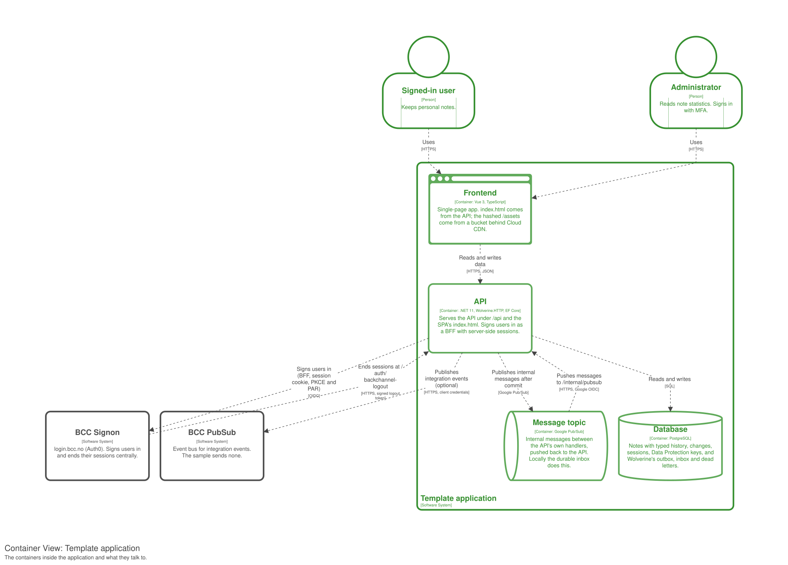
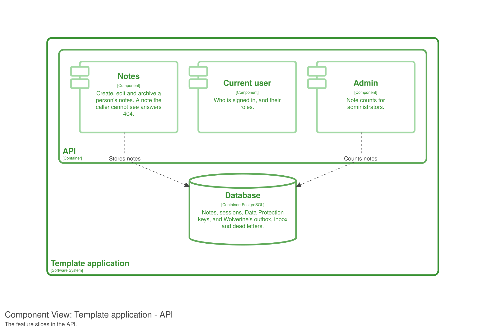
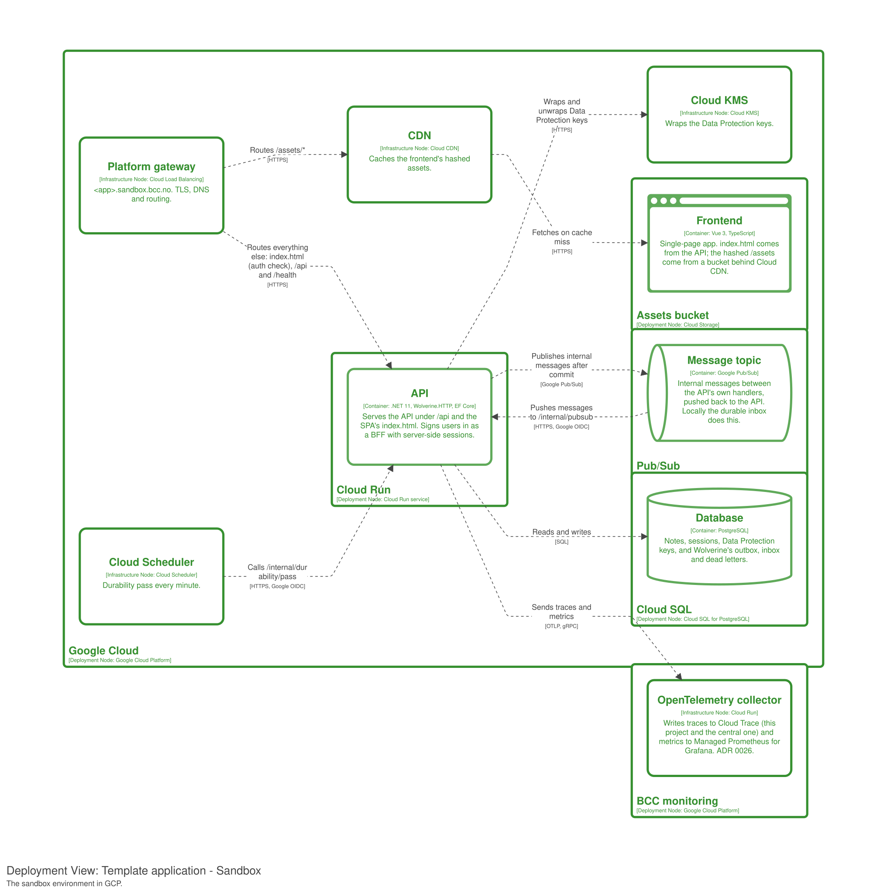
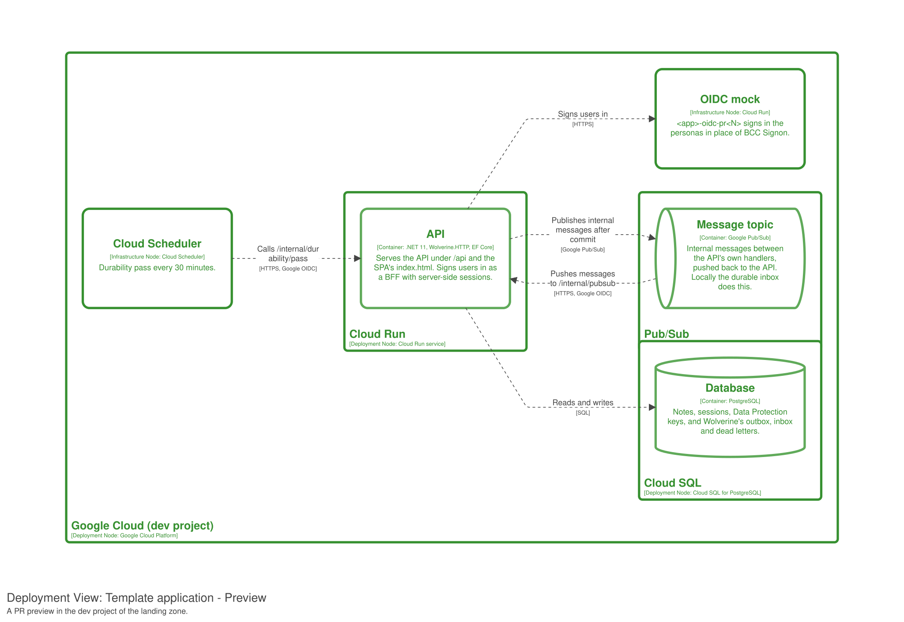
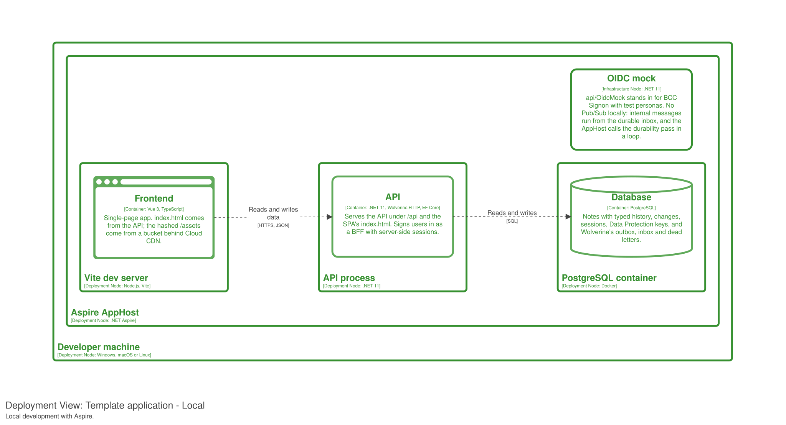

# Architecture

C4 model of the template application. The source is [workspace.dsl](workspace.dsl) (Structurizr DSL); the SVGs in [diagrams/](diagrams/) are exported from it. Why it is set up this way: [ADR 0018](../adrs/0018-c4-diagrams-with-structurizr.md).

The model shows the Notes sample as built: the SPA served by the API on one origin, Postgres, the internal message topic, BCC Signon, the platform gateway and the BCC monitoring collector. An application made from the template renames the system in `workspace.dsl`, replaces the slices on the component view and adds its own integrations.

## Diagrams

### System context



### Containers



### Components of the API



### Deployment: sandbox



### Deployment: PR preview



### Deployment: local



## Edit the model

1. Start the app with `aspire run` and open the `architecture` resource (the "C4 diagrams" link in the dashboard). It takes about half a minute to start.
2. Edit `workspace.dsl` and refresh the browser. Every view starts with `autolayout`. To lay a view out by hand, remove its `autolayout` line and drag the elements; Structurizr saves the positions to `workspace.json` a few seconds later.
3. Export and commit `workspace.dsl`, `workspace.json` and `diagrams/` together:

   ```powershell
   ./docs/architecture/export.ps1
   ```

   ```bash
   docs/architecture/export.sh
   ```

   The script applies the layout in `workspace.json` to the model in `workspace.dsl` and renders that. The first export pulls the `-playwright` image (about 2 GB). Both scripts give the same files.
4. Check that the diagrams match the sources: `docs/architecture/export.sh --check` (no Docker needed).

Open the diagrams in Structurizr before you export: after a DSL change it rewrites `workspace.json` once, and an export made before that is stale. CI's `architecture` job validates the DSL and fails when `diagrams/source.sha256` does not match `workspace.dsl`, `workspace.json` and the export image.

Without Aspire, regenerate `workspace.json` from the DSL with the same image the export uses (`export -format json`), copy the result over `workspace.json`, then run the export script.

## Rules of thumb

- Describe each relationship by why it exists ("Counts notes"), not only the protocol.
- Positions are matched by element name. Renaming an element in the DSL drops its position; place it again in Structurizr.
- A new view needs a description and a section above.
- The image versions are in [Dockerfile](Dockerfile). When you raise them, run the export in the same PR.
