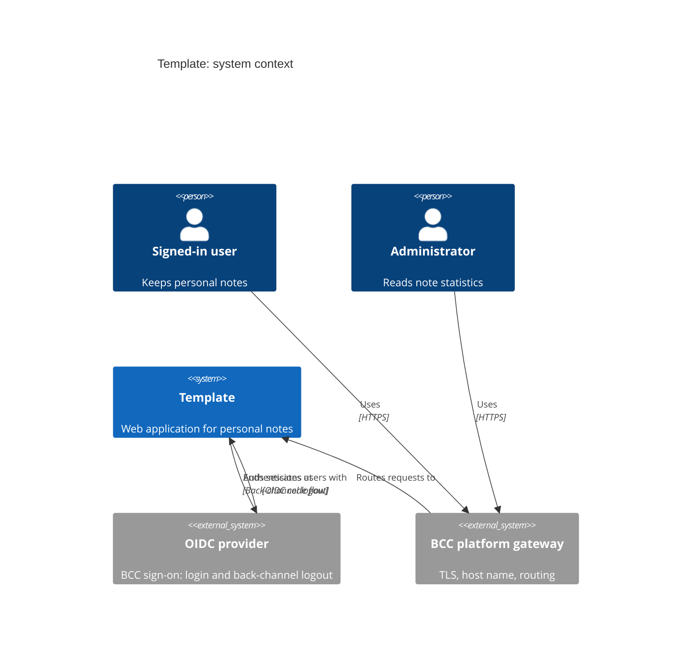
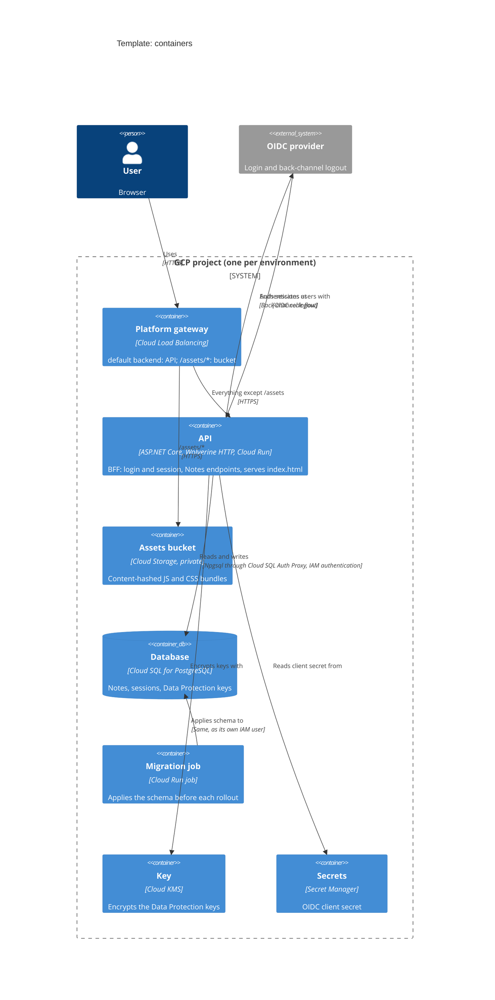

# Architecture

The system as built, as C4 diagrams. The source is the Mermaid text in this file (rendered by GitHub and most editors).

TODO: standard 23, rule 4 asks for an exported SVG next to the source. Export each diagram with `mmdc` (Mermaid CLI) or the
Mermaid live editor into this folder when the diagrams have settled, and keep both in step.

## Context

Who uses the application and which systems it talks to.

## Containers

What runs and how requests flow. The API serves `index.html` and every `/api` route. Only the content-hashed bundles under
`/assets` come from the bucket (standard 26).

The browser holds a session cookie only. Tokens stay on the server ([ADR 0004](../adrs/0004-bff-authentication-with-server-side-sessions.md)).

## Variants

The template has two APIs with the same behaviour and the same HTTP contract: `BccCode.Template.Api.Marten` (event-sourced
notes) and `BccCode.Template.Api.EfCore` (relational notes). Both use `BccCode.Template.Web` for the shared HTTP plumbing.
After `scripts/init-app.ps1` only one remains ([ADR 0003](../adrs/0003-marten-or-ef-core.md)).

## Local development

The Aspire AppHost starts the API, Postgres, the OIDC mock and the frontend dev server. See [../development.md](../development.md).
